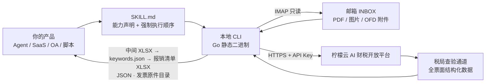

# invoice-reimbursement-assistant · 柠檬云发票整理、查验及报销助手 Skill

> **给开发者**：把「邮箱自动收票 → 发票识别查验 → 查重 → 费用分类 → 抬头校验 → 标准化报销清单」这条链路，免费接进你自己的 AI Agent、SaaS 或工作流。不用自己写 IMAP 客户端、不用对接税局查验通道、也不用让员工一张张从邮件里翻附件。

**Open-source Chinese invoice collection & reimbursement Skill for AI agents** — MIT licensed · IMAP inbox ingestion · real-time tax bureau verification · duplicate detection · structured XLSX / JSON output · free API key · Go static binary.

     

[开放平台首页](https://www.nmy.cn) · [Skill 列表](https://www.nmy.cn/skills) · [开放 API 文档](https://opendocs.nmy.cn) · [总集合仓库 lemon_skill](https://github.com/ningmengyun12366/lemon_skill) · [能力矩阵](#这个仓库背后是一整套免费开放能力) · [30 秒跑起来](#30-秒跑起来)

---

## TL;DR：这个仓库解决什么问题

做报销相关的 AI 产品，最难受的不是"让模型读发票"，而是把**散落在邮箱里的票**变成一份**财务敢收的清单**：

| 你要做的事      | 自己从零做                           | 用 `invoice-reimbursement-assistant`                              |
| ---------- | ------------------------------- | ---------------------------------------------------------------- |
| 把邮箱里的发票收齐  | 自己写 IMAP 客户端、处理授权码、过滤附件类型、排除行程单 | 一条 `phase1` 命令按日期范围与关键字抓取 INBOX 里的 PDF / 图片 / OFD 附件             |
| 判断票是不是真的   | 对接查验通道、处理限频与状态轮询、识别作废 / 红冲 / 失控 | 实时连接查验接口，产物保留「税局查验状态」「查验时间」字段                                    |
| 防重复报销      | 自建发票代码 + 号码的查重规则                | `phase2` 输出重复发票统计，按代码与号码识别                                       |
| 抬头合规       | 人工比对购买方名称                       | `--company` 做企业抬头校验；出现多抬头时原样返回 `company_names`，等用户确认后仅重跑阶段 2     |
| 费用分类       | 维护一套关键词 → 费用项目 / 报销事由映射表        | AI 中间分析基于 `line_items_summary` 生成 `keywords.json`，`phase2` 按映射分类 |
| 出一份能交的报销清单 | 手工整理 Excel、排序、归档原件              | 按费用类型 / 金额 / 日期输出标准化 XLSX + 发票原件目录                               |
| 接进已有系统     | 自己设计接口、鉴权、错误码                   | stdout 纯 JSON、失败也是 JSON，诊断走 stderr，可直接管道接进服务                     |

**它是一个 Skill，也是一个 CLI。** 既可以挂到遵循 `SKILL.md` 规范的 Agent 上，也可以当作命令行工具嵌进 OA、报销系统、票据中台或你自己的 SaaS。

---

## 这个仓库开源了什么

MIT 协议，可商用、可修改、可二次分发。仓库里是**完整可读的 Skill 层实现**，不是只放一个安装包：

| 路径                                                                                                                                                           | 内容                                                                                                                               | 你能拿它做什么                                  |
| ------------------------------------------------------------------------------------------------------------------------------------------------------------ | -------------------------------------------------------------------------------------------------------------------------------- | ---------------------------------------- |
| [`invoice-reimbursement-assistant/SKILL.md`](./invoice-reimbursement-assistant/SKILL.md)                                                                     | 给模型看的能力定义与执行规范：参数规格、`phase1 → reverify → AI 中间分析 → phase2` 强制顺序、邮箱扫描与附件识别规则、多抬头处理、输出模板                                           | 读懂一个"邮箱到报销清单"的可审计流程该怎么被约束；照着改成你自己的 Skill |
| [`invoice-reimbursement-assistant/README.md`](./invoice-reimbursement-assistant/README.md)                                                                   | 发布包内的使用者说明：API Key 获取（绑定「发票查验」）与邮箱授权码配置                                                                                          | 直接复用为你的产品文档                              |
| [`invoice-reimbursement-assistant/invoice-reimbursement-assistant-install.md`](./invoice-reimbursement-assistant/invoice-reimbursement-assistant-install.md) | 安装 / 更新 / 回滚流程、多平台二进制下载约定                                                                                                        | 参考它的自动更新与失败回滚设计                          |
| [`go-script/lib/invoice-verify-common/mailimap/`](./go-script/lib/invoice-verify-common/mailimap/)                                                           | IMAP 连接、邮件抓取、附件识别与落盘                                                                                                             | 复用或替换邮箱接入层                               |
| [`go-script/lib/invoice-verify-common/reimbursement/`](./go-script/lib/invoice-verify-common/reimbursement/)                                                 | `phase1` 编排、费用分类 `classify`、清单预处理                                                                                                | 看懂费用分类与报销清单是怎么生成的                        |
| `go-script/lib/invoice-verify-common/` 其余模块                                                                                                                  | `invoicecore` 批量查验与并发、`verifyapi` 查验客户端、`qrcode` / `pdfextract` / `ofd` 版式解析、`excelx` 表格、`reportpdf` 报表、`runtimeio/redact.go` 脱敏 | 复用发票处理底座，避免重复造轮子                         |
| [`go-script/build.js`](./go-script/build.js) · `go-script/config/prod.json` · [`package.json`](./package.json)                                               | 生产打包脚本、接口端点注入、`npm run build`                                                                                                    | 从源码构建你自己的发布包                             |
| [`SECURITY.md`](./SECURITY.md)                                                                                                                               | 私下报告安全问题的通道                                                                                                                      | —                                        |
| [`THIRD_PARTY_NOTICES.md`](./THIRD_PARTY_NOTICES.md) · [`LICENSE`](./LICENSE)                                                                                | 第三方组件与字体许可、MIT 许可                                                                                                                | —                                        |

**边界说清楚**：本仓库开源的是 Skill 定义、文档与客户端实现；发票查验服务端接口与税局通道由[柠檬云 AI 财税能力开放平台](https://www.nmy.cn)提供，运行时需要一个 API Key。邮箱 IMAP 访问**只用于读取邮件附件**，与发票查验 API Key 是两套独立凭据，互不相干；邮箱授权码按敏感信息处理，不得在回复中回显完整内容。这样设计是为了让查验口径与票据状态始终由服务端对齐税局，同时把邮箱访问限制在只读范围内。

运行环境与发布约定：Node.js 20+ / Go 1.24+ 用于本地构建；发布物生成在 `dist/Skills/invoice-reimbursement-assistant/`；运行时 ZIP 不含 `bin/**` 二进制，安装时按当前平台单独下载。支持 Windows amd64、Linux amd64/arm64、macOS amd64/arm64。

---

## 这个仓库背后是一整套免费开放能力

`invoice-reimbursement-assistant` 是[柠檬云 AI 财税能力开放平台](https://www.nmy.cn)开源出来的其中一个 Skill。开发者免费注册后，可以按需要单独接入某一项能力，也可以把整条财税链路补齐到自己的产品里——**不用换系统、不用让用户跳到另一个平台**。

| 能力                               | 状态         | 典型集成场景                     | 源码 / 入口                                                                                                              |
| -------------------------------- | ---------- | -------------------------- | -------------------------------------------------------------------------------------------------------------------- |
| **发票整理、查验及报销助手**（本仓库）            | 已上线        | 员工报销、票据中台、邮箱收票自动化          | [`invoice-reimbursement-assistant-skill`](https://github.com/ningmengyun12366/invoice-reimbursement-assistant-skill) |
| 全场景开票                            | 已上线        | 电商、ERP、CRM 的自动开票模块         | [`invoice-issue-skill`](https://github.com/ningmengyun12366/invoice-issue-skill)                                     |
| 发票查验查重及台账                        | 已上线        | 报销系统、差旅平台、财务共享中心           | [`batch-invoice-verify-skill`](https://github.com/ningmengyun12366/batch-invoice-verify-skill)                       |
| 企业发票核验与征信分析                      | 已上线        | 供应链风控、供应商准入、贷前尽调           | [`invoice-verify-analysis-skill`](https://github.com/ningmengyun12366/invoice-verify-analysis-skill)                 |
| 发票获取及风险分析                        | 已上线        | 代账机构批量体检、财税健康度看板           | [`invoice-fetch-and-risk-analysis-skill`](https://github.com/ningmengyun12366/invoice-fetch-and-risk-analysis-skill) |
| 企业税务风险分析                         | 已上线        | 财税顾问交付、税务自查、尽调报告           | [`tax-analysis-skill`](https://github.com/ningmengyun12366/tax-analysis-skill)                                       |
| AI 财税专家咨询 · 财税知识库                | 已上线        | 财税问答机器人、Agent 的政策依据兜底、合规留痕 | [`tax-knowledge-skill`](https://github.com/ningmengyun12366/tax-knowledge-skill)                                     |
| 财务软件账套连接器                        | 已上线        | 在 AI 里直接查账、出表、做经营分析        | [Skill 列表](https://www.nmy.cn/skills)                                                                                |
| 资金全流程管理（银行流水 / 回单 / 自动对账 / 资金报表） | 官方路线图，即将上线 | 资金看板、现金流分析                 | [开放平台](https://www.nmy.cn)                                                                                           |

> 想要一次性拿到全部 Skill 的源码与能力矩阵，看总集合仓库 [`lemon_skill`](https://github.com/ningmengyun12366/lemon_skill)。每个子仓库可独立使用，不需要整套引入。

### 需要做系统集成？还有标准化 REST API

除了 Skill，开放平台还把税局侧的高频操作开放成了 REST 接口，文档在 **[opendocs.nmy.cn](https://opendocs.nmy.cn)**：

- **登录业务**：企业登录 API、代理企业登录 API（QYYW / ZRRYW / DLYW 三类登录，异步任务 + 验证码流程）
- **发票同步**：发票数据同步、勾选数据同步、发票附件下载（PDF / OFD 版式文件）
- **发票查验**：与全国增值税查验平台口径一致的单张查验，同步返回查验结论及全票面结构化数据
- **发票开具**：蓝字数电发票开具、红字发票全流程（确认单同步 / 创建 / 确认 / 拒绝 / 撤销）
- **开票基础能力**：基础信息与授信查询、客户与商品信息维护、人脸认证、税率与票种字典

两种接入方式的凭据是不同的，别混用：

| 接入方式            | 凭据                                                     | 适合谁                        |
| --------------- | ------------------------------------------------------ | -------------------------- |
| 调用 Skill / CLI  | 控制台创建的 **API Key**（绑定「发票查验」及企业）+ 邮箱 **IMAP 授权码**（只读附件） | 个人开发者、AI Agent、SaaS 产品快速验证 |
| 直连开放平台 REST API | 接入申请后由平台提供 **appId / appSecret** 与正式接口地址               | ISV、ERP/OA 厂商做产品级集成        |

注册即享**月度免费调用额度，月月重置**，具体额度、有效期与计费规则以开放平台控制台显示为准；产品级用量、商用授权与更高配额可在控制台查看或联系平台客服。

---

## 30 秒跑起来

### 1. 拿一个免费 API Key，并准备邮箱授权码

到 [柠檬云 AI 财税能力开放平台](https://www.nmy.cn) 注册登录 → 进入控制台 → **API Key 管理** → 新建 Key，**绑定权限时勾选「发票查验」** → 复制 Key。再到你要收票的邮箱开启 IMAP 并获取**授权码**（不是登录密码）。

> API Key 与邮箱授权码都只在运行时通过命令行参数传入，不要写进源码、配置样例、日志或 Issue；邮箱授权码属于敏感信息，对话中不得回显完整内容。

### 2. 安装 Skill

**方式 A · 交给 Agent 自动装**：在 [Skill 列表](https://www.nmy.cn/skills) 找到「发票整理、查验及报销助手」，复制安装链接，粘贴到你的 AI 客户端对话框即可。

**方式 B · 当作 CLI 直接用**（推荐给产品集成）：按 [`invoice-reimbursement-assistant-install.md`](./invoice-reimbursement-assistant/invoice-reimbursement-assistant-install.md) 安装发布包与当前平台二进制；也可以从本仓库源码自行构建。

### 3. 调一次

```bash
# 阶段 1：邮箱抓票 → 附件识别 → 发票查验，输出中间 XLSX
invoice-reimbursement-assistant phase1 \
  --email you@example.com \
  --password "$IMAP_AUTH_CODE" \
  --start-date 20260101 \
  --end-date 20260131 \
  --invoice-dir ./invoices \
  --api-key "$LEMON_API_KEY" \
  --mail-provider qq \
  --keyword "报销"

# 阶段 2：费用分类 + 抬头校验 + 标准化报销清单
invoice-reimbursement-assistant phase2 \
  --verify-excel ./发票查验_中间结果（系统生成，请勿使用）.xlsx \
  --keywords-file ./invoices/keywords.json \
  --company "示例科技有限公司" \
  --output-excel ./发票报销清单.xlsx
```

需要重查查验失败或空结果时，在阶段 1 与阶段 2 之间插入一次 `reverify`：

```bash
invoice-reimbursement-assistant reverify \
  --verify-excel <阶段1中间XLSX> --api-key "$LEMON_API_KEY"
```

Windows PowerShell 里首次调用本地二进制前，把 UTF-8 初始化和命令放在同一次终端调用中：

```powershell
$Utf8NoBom = New-Object System.Text.UTF8Encoding($false)
[Console]::InputEncoding = $Utf8NoBom
[Console]::OutputEncoding = $Utf8NoBom
$OutputEncoding = $Utf8NoBom
.\bin\windows-amd64\invoice-reimbursement-assistant.exe phase1 --email you@example.com --password "$env:IMAP_AUTH_CODE" --start-date 20260101 --end-date 20260131 --invoice-dir .\invoices --api-key "$env:LEMON_API_KEY" --mail-provider qq
```

阶段 1 与阶段 2 之间还有一步 **AI 中间分析**：读取阶段 1 返回的 `line_items_summary`，生成费用分类映射 `keywords.json`（格式如下），再交给 `phase2`：

```json
{
  "关键字": ["费用分类", "报销事由"],
  "饮料": ["员工福利", "办公室饮用补助"],
  "办公": ["办公用品", "办公采购费"]
}
```

最终输出模板包含：命中发票相关邮件数、行程单附件数、提取发票文件数、查验通过数、异常文件数、重复发票数，以及报销清单路径与发票原件目录。阶段 2 的 XLSX 保留「税局查验状态」「查验时间」，默认文件名 `发票报销清单yyyyMMddHHmmss.xlsx`。

业务命令 stdout 是可解析 JSON，失败时 stdout 仍返回 JSON 错误对象，诊断与进度一律走 stderr——**可以直接用管道接进你自己的服务**。邮箱扫描固定为 IMAP `INBOX`，范围只由邮箱账号、日期范围与可选关键字决定；仅识别 PDF、JPG/JPEG/PNG、OFD 附件，文件名命中"行程单"的附件会保存计数但不进入查验与报销清单链路。支持 `qq` / `163` / `gmail`，自定义邮箱改用 `--imap-host` 与 `--port`（默认 993）。

---

## 它是怎么工作的



几个为了让集成省事的取舍：

- **薄 Agent、厚 CLI**：IMAP 连接、附件识别、版式解析、批量查验并发、轮询、结果归档收敛在 CLI 里，模型只负责理解意图、生成分类映射和按模板组织答案。换个模型版本不会把链路跑断。
- **流程硬门禁**：必须按「阶段 1 → 可选 `reverify` → AI 中间分析（生成 `keywords.json`）→ 阶段 2」顺序执行，禁止跳步；禁止假设中间表已存在、禁止复用旧批次文件冒充本次产物。阶段 1 只做下载、解析与查验，**不做查重、不做抬头校验、不做报销分析**。
- **邮箱只读、职责隔离**：固定扫描 `INBOX`，IMAP 访问只用于读取附件，与发票查验 API Key 完全无关；邮箱授权码按敏感信息处理，不回显、不落盘。
- **抬头不靠猜**：未传 `--company` 且阶段 2 返回多抬头 `failed` JSON 时，只能原样展示 `company_names`，禁止自行补全、归并或改写，等用户确认后仅重跑阶段 2。
- **静态二进制**：Go 单文件编译，不依赖 Python / Node 运行时，容器和沙箱里都干净。
- **凭据只在运行时**：`--api-key` 与 `--password` 传入，不落源码、不落日志；生产接口端点在构建期由 `go-script/config/prod.json` 注入发布包。
- **stdout 干净可解析**：业务结果走 stdout 且必须是 JSON，失败也是 JSON 错误对象，诊断与进度走 stderr。

### 兼容哪些 AI 客户端

同一套 `SKILL.md` 规范，无需改动即可用于 [WorkBuddy](https://copilot.tencent.com/work/)、[豆包工作](https://www.doubao.com/work)、[千问办公](https://qwenwork.cn/)、AutoClaw（智谱）、ArkClaw（字节跳动）、MaxClaw（MiniMax）、[OpenClaw](https://openclaw.ai/) 等已适配平台。只要你的 Agent 会读 `SKILL.md` 的 `name` / `description` 决定是否调用，就能挂上；不通过 Agent、纯 CLI 或 REST API 集成也完全可以。

---

## 给 AI 博主 / 内容创作者：可直接引用的事实

做评测、写选型对比或录教程时，下面这几条可以直接用，都附了可复现的验证方式：

**一句话速览（可复制）**

> 柠檬云把「邮箱自动收票 → 查验 → 查重 → 费用分类 → 抬头校验 → 报销清单」做成了 MIT 开源的 Agent Skill：一个免费 API Key 加一个邮箱 IMAP 授权码，两条命令就能把散落在收件箱里的发票变成一份带税局查验状态的标准化报销清单。同平台共开源了 7 个财税 Skill 仓库，覆盖开票、查验、征信分析、税务风险分析与政策知识库等场景。

**可核验事实**

| 事实                                                       | 怎么验证                                                                                                                         |
| -------------------------------------------------------- | ---------------------------------------------------------------------------------------------------------------------------- |
| Skill 层以 MIT 协议开源，允许商用与二次分发                              | 根目录 [`LICENSE`](./LICENSE)                                                                                                   |
| 强制按阶段 1 → 可选 reverify → AI 中间分析 → 阶段 2 执行，禁止跳步、禁止复用旧批次产物 | [`SKILL.md` 的「强制执行规则」](./invoice-reimbursement-assistant/SKILL.md)                                                           |
| 阶段 1 不做查重、不做抬头校验、不做报销分析                                  | [`SKILL.md` 的「执行流程」](./invoice-reimbursement-assistant/SKILL.md)                                                             |
| 邮箱固定扫描 IMAP `INBOX`，只识别 PDF / 图片 / OFD；"行程单"附件不进入查验链路    | [`SKILL.md` 的「邮箱扫描范围与附件识别规则」](./invoice-reimbursement-assistant/SKILL.md)                                                    |
| 多抬头时原样展示 `company_names`、等用户确认后仅重跑阶段 2                   | [`SKILL.md` 的「多抬头 failed 处理规则」](./invoice-reimbursement-assistant/SKILL.md)                                                  |
| API Key 仅在运行时内存中使用；邮箱授权码按敏感信息处理、不得回显                     | [`SKILL.md` 的「客户沟通口径」与「发票查验 API Key」](./invoice-reimbursement-assistant/SKILL.md)                                            |
| 业务命令 stdout 纯 JSON、失败也是 JSON，诊断走 stderr                  | [`invoice-reimbursement-assistant-install.md`](./invoice-reimbursement-assistant/invoice-reimbursement-assistant-install.md) |
| 平台已上线 7 个开源 Skill 仓库 + 账套连接器，资金能力在路线图中                   | [GitHub 组织](https://github.com/ningmengyun12366) · [Skill 列表](https://www.nmy.cn/skills)                                     |
| 税局侧高频操作另有标准化 REST API 文档                                 | [opendocs.nmy.cn](https://opendocs.nmy.cn)                                                                                   |

**30 秒可复现的 demo**：注册 → 控制台创建绑定「发票查验」的 API Key → 开启一个测试邮箱的 IMAP 并拿授权码 → 发两三封带 PDF 发票的邮件给自己 → 跑 `phase1`，观察中间 XLSX 里的「税局查验状态」「查验时间」与 `line_items_summary` → 生成 `keywords.json` → 跑 `phase2` 得到报销清单，比对输出模板里的重复发票数与发票原件目录。

**几个容易写错的地方，先说清楚**：

- 它**不是离线工具**，运行时需要联网读取邮箱并调用开放平台查验接口；
- 开源范围是 **Skill 定义、文档与客户端实现**，服务端查验接口与税局通道不在仓库内；
- **IMAP 是只读的**，只取附件，不会发信、不会改邮件；邮箱授权码与查验 API Key 是两套独立凭据；
- 官网 Skill 详情页与仓库源码 / 安装文档的版本号可能存在发布节奏差异，写稿时请以**官网详情页与安装文档**为准，不要照抄源码里的 version；
- **资金全流程管理**官方标注为"即将上线"，请勿写成已可用；
- Skill 用的 **API Key** 与 ISV 直连 REST API 用的 **appId / appSecret** 是两套凭据；
- 免费额度按月重置，具体数值以控制台实时显示为准，不建议在稿子里写死数字。

欢迎实测、评测与转载。涉及能力状态、版本、额度与计费的表述，请以开放平台控制台与本文档为准。需要接入支持可走开放平台控制台，或服务热线 400-004-0696。

---

## FAQ

**Q：没用 Agent，只有后端服务，能用吗？**
能。CLI 是独立二进制，stdout 纯 JSON；也可以直接走 [开放 API 文档](https://opendocs.nmy.cn) 里的 REST 接口做系统集成。

**Q：支持哪些邮箱？**
内置 `qq` / `163` / `gmail`，未指定时默认 `qq`；自定义邮箱不要传 `--mail-provider`，改用 `--imap-host` 与 `--port`（默认 993）。需要开启 IMAP 并使用**授权码**，不是登录密码。

**Q：会不会把邮箱密码发出去？**
不会。IMAP 访问只用于读取邮件附件，与发票查验 API Key 无关；授权码按敏感信息处理，不得在回复中回显完整内容，也不写入源码、配置、日志或输出文件。

**Q：能防重复报销吗？**
能，但发生在阶段 2：按发票代码与号码识别重复发票并在输出统计中给出数量。阶段 1 只做下载、解析与查验，不做查重，请勿写成"抓票时就去重"。

**Q：企业抬头对不上会怎样？**
未传 `--company` 且阶段 2 返回多抬头 `failed` JSON 时，会原样列出 `company_names` 并等待确认，确认后仅重跑阶段 2；不会自行猜测或归并抬头。

**Q：开源范围包含查验接口和税局通道吗？**
不包含。MIT 覆盖本仓库自有代码、文档与资源；查验服务端与税局对接能力由开放平台提供，需要 API Key。这样查验口径与票据状态由服务端统一维护。

**Q：能商用吗？**
MIT 允许商用与二次分发。具体调用额度、产品级用量与商用授权以开放平台控制台与平台说明为准。

**Q：支持哪些平台和 Agent？**
Windows amd64、Linux amd64/arm64、macOS amd64/arm64；遵循 `SKILL.md` 规范的 Agent 客户端均可挂载，已适配的主流平台见上文。

**Q：报告安全问题走哪个渠道？**
请勿开公开 Issue，按 [`SECURITY.md`](./SECURITY.md) 使用 Private vulnerability reporting 私下提交；报告里不要附 API Key、邮箱授权码、真实企业数据或未脱敏日志。

---

## 自己构建

```bash
npm ci
npm run build
# 等价于：node go-script/build.js --env prod invoice-reimbursement-assistant
```

生产发布物落在 `dist/Skills/invoice-reimbursement-assistant/`。ZIP 包不含 `bin/**` 二进制，安装时按 [`invoice-reimbursement-assistant-install.md`](./invoice-reimbursement-assistant/invoice-reimbursement-assistant-install.md) 的下载表只拉取当前平台对应的一个二进制。

## 配置与数据安全

- API 凭据与邮箱授权码由使用者在运行时传入，不应写入源码、文档、配置、日志或提交记录。
- 生产接口端点通过 `go-script/config/prod.json` 在构建期注入发布包；包内 `config/verify-api.json` 只放接口端点与能力配置。
- 日志与输出经过脱敏处理（`go-script/lib/invoice-verify-common/runtimeio/redact.go`）。
- 邮箱访问仅限 IMAP 只读附件；发票、报销单据属于敏感业务数据，请按你所在场景的合规要求进行存储与留痕。
- 第三方组件与字体许可见 [`THIRD_PARTY_NOTICES.md`](./THIRD_PARTY_NOTICES.md)。

## 反馈与贡献

集成问题、适配需求与功能建议，欢迎通过仓库 Issue 反馈；若你写了文章、录了教程或基于本仓库做了二次开发，也欢迎贴链接，我们会收录并协助传播。安全问题的私下报告渠道见 [`SECURITY.md`](./SECURITY.md)。

## 许可证

本项目自有代码、文档与资源文件采用 [MIT License](./LICENSE)，允许商用与二次分发。

---

## English / 搜索索引

`invoice-reimbursement-assistant` is an MIT-licensed, open-source Agent Skill for **Chinese invoice collection and reimbursement automation**. It reads invoice attachments (PDF / JPG / PNG / OFD) from an IMAP inbox within a date range, verifies them against the tax bureau channel, detects duplicate invoices by code and number, classifies expenses through a generated `keywords.json`, validates the company header, and produces a standardized XLSX reimbursement ledger plus an archive of original invoice files. A hard-gated `phase1 → reverify → AI intermediate analysis → phase2` workflow forbids skipping stages or reusing stale artifacts. It is one of seven Skills open-sourced by the [Ningmengyun AI Finance & Tax Open Platform](https://www.nmy.cn), which also provides standardized REST APIs for invoice issuance, verification, synchronization and tax login. A free API key with a monthly quota is available after registration.

**Search terms / 检索关键词**：邮箱收票 · 发票报销清单 · 发票查重 · 抬头校验 · 费用分类 · IMAP 发票采集 · 数电发票 · 发票查验 API · 报销自动化 · 财税 AI · Agent Skill · SKILL.md · MCP tool-use · AI Agent 财税能力 · 开源财税 Skill · Go CLI structured JSON · invoice reimbursement automation · email invoice extraction · IMAP invoice parser · duplicate invoice detection · expense categorization · fapiao · Chinese VAT invoice · invoice verification API China · OpenClaw / WorkBuddy skill

---

**给你的 AI 产品补一块「中国财税」的专业能力，从这里开始。**

[免费获取 API Key](https://www.nmy.cn) · [浏览全部 Skill](https://www.nmy.cn/skills) · [开放 API 文档](https://opendocs.nmy.cn) · [总集合仓库 lemon_skill](https://github.com/ningmengyun12366/lemon_skill)

<sub>本仓库由深圳易财信息技术有限公司（柠檬云）维护。
